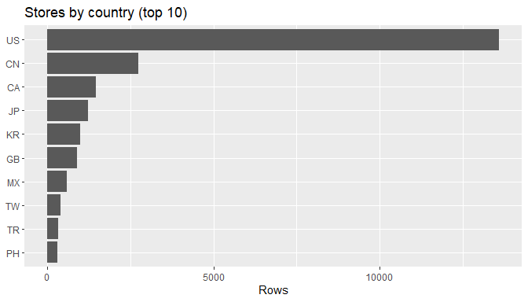
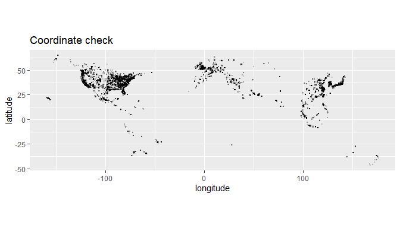

Starbucks store locations: EDA and cleaning
================
Odia
2026-11-18

- [1. What this report does](#1-what-this-report-does)
- [2. Load the data](#2-load-the-data)
- [3. Clean the data](#3-clean-the-data)
- [4. Add a few simple columns](#4-add-a-few-simple-columns)
- [5. Explore the data](#5-explore-the-data)
  - [Brand and ownership](#brand-and-ownership)
  - [continent](#continent)
  - [Countries](#countries)
- [6. Two quick checks (plots)](#6-two-quick-checks-plots)
- [8. Save the clean file for
  Tableau](#8-save-the-clean-file-for-tableau)
- [Limits](#limits)

# 1. What this report does

This is a public list of Starbucks stores, downloaded from Kaggle. It is
a learning project. The snapshot date and how the data was collected are
unknown.

The report does four things: loads the file, cleans it, and saves a
clean file for Tableau.

# 2. Load the data

We read every column as text, so nothing is changed by accident.
`na = character()` stops R from treating the text “NA” as missing,
because “NA” is also the country code for Namibia. `read_csv` removes
spaces at the start and end of each value.

``` r
raw <- read_csv("\data\raw\directory.csv",
                col_types = cols(.default = col_character()),
                na = character())

# The original column names have spaces and a slash, so give them simple names
raw <- raw %>%
  rename(brand = Brand, store_number = `Store Number`, store_name = `Store Name`,
         ownership_type = `Ownership Type`, street_address = `Street Address`,
         city = City, state_province = `State/Province`, country = Country,
         postcode = Postcode, phone_number = `Phone Number`, timezone = Timezone,
         longitude = Longitude, latitude = Latitude)

dim(raw)    # expect 25600 rows and 13 columns
```

    ## [1] 25600    13

``` r
head(raw)
```

    ## # A tibble: 6 × 13
    ##   brand     store_number store_name          ownership_type street_address city 
    ##   <chr>     <chr>        <chr>               <chr>          <chr>          <chr>
    ## 1 Starbucks 47370-257954 Meritxell, 96       Licensed       Av. Meritxell… Ando…
    ## 2 Starbucks 22331-212325 Ajman Drive Thru    Licensed       1 Street 69, … Ajman
    ## 3 Starbucks 47089-256771 Dana Mall           Licensed       Sheikh Khalif… Ajman
    ## 4 Starbucks 22126-218024 Twofour 54          Licensed       Al Salam Stre… Abu …
    ## 5 Starbucks 17127-178586 Al Ain Tower        Licensed       Khaldiya Area… Abu …
    ## 6 Starbucks 17688-182164 Dalma Mall, Ground… Licensed       Dalma Mall, M… Abu …
    ## # ℹ 7 more variables: state_province <chr>, country <chr>, postcode <chr>,
    ## #   phone_number <chr>, timezone <chr>, longitude <chr>, latitude <chr>

# 3. Clean the data

Each step below is small. Nothing is deleted except the one repeated
Store Number.

``` r
# Step 1: blank values become NA (R's way of saying "missing")
clean <- raw %>%
  mutate(across(everything(), ~ na_if(.x, "")))

# Step 2: the text "NA" in postcode and city also means missing
clean <- clean %>%
  mutate(postcode = na_if(postcode, "NA"),
         city = na_if(city, "NA"))

# Keep a copy of the cleaned data before removing the repeated Store Number
before_dedup <- clean

# Step 3: coordinates become numbers
clean <- clean %>%
  mutate(longitude = as.numeric(longitude),
         latitude = as.numeric(latitude))

# Step 4: Check to confirm Grain using Store Number, to confirm one row = one store number.
# Keep one row per Store Number if likely. We put rows WITH coordinates first,
# so the row with coordinates is the one that stays.
clean <- clean %>%
  mutate(row_id = row_number(), .before = 1) %>%
  arrange(store_number, is.na(longitude)) %>%
  distinct(store_number, .keep_all = TRUE) %>%
  arrange(row_id)

nrow(raw) - nrow(clean)   # expect 1 row removed
```

    ## [1] 1

# 4. Add a few simple columns

``` r
clean <- clean %>%
  mutate(
    # Extract the continent safely even if there is no space prefix
    tz_clean = if_else(str_detect(timezone, " "), str_split_i(timezone, " ", 2), timezone),
    continent = str_split_i(tz_clean, "/", 1)
  ) %>%
  select(-tz_clean)

clean
```

    ## # A tibble: 25,599 × 15
    ##    row_id brand     store_number store_name  ownership_type street_address city 
    ##     <int> <chr>     <chr>        <chr>       <chr>          <chr>          <chr>
    ##  1      1 Starbucks 47370-257954 Meritxell,… Licensed       Av. Meritxell… Ando…
    ##  2      2 Starbucks 22331-212325 Ajman Driv… Licensed       1 Street 69, … Ajman
    ##  3      3 Starbucks 47089-256771 Dana Mall   Licensed       Sheikh Khalif… Ajman
    ##  4      4 Starbucks 22126-218024 Twofour 54  Licensed       Al Salam Stre… Abu …
    ##  5      5 Starbucks 17127-178586 Al Ain Tow… Licensed       Khaldiya Area… Abu …
    ##  6      6 Starbucks 17688-182164 Dalma Mall… Licensed       Dalma Mall, M… Abu …
    ##  7      7 Starbucks 18182-182165 Dalma Mall… Licensed       Dalma Mall, M… Abu …
    ##  8      8 Starbucks 23359-229184 Debenhams … Licensed       Yas Island     Abu …
    ##  9      9 Starbucks 30781-99022  Khalidiya … Licensed       Khalidiya St.  Abu …
    ## 10     10 Starbucks 20423-205465 Eastern Ma… Licensed       Al Salam Stre… Abu …
    ## # ℹ 25,589 more rows
    ## # ℹ 8 more variables: state_province <chr>, country <chr>, postcode <chr>,
    ## #   phone_number <chr>, timezone <chr>, longitude <dbl>, latitude <dbl>,
    ## #   continent <chr>

# 5. Explore the data

## Brand and ownership

``` r
clean %>% 
  count(brand, sort = TRUE) %>%
  mutate(
    share_pct = round(100 * n / sum(n), 2)
  )
```

    ## # A tibble: 4 × 3
    ##   brand                     n share_pct
    ##   <chr>                 <int>     <dbl>
    ## 1 Starbucks             25248     98.6 
    ## 2 Teavana                 348      1.36
    ## 3 Evolution Fresh           2      0.01
    ## 4 Coffee House Holdings     1      0

``` r
clean %>% 
  count(
    ownership_type, sort = TRUE
  ) %>% 
  mutate(
    share_pct = round(100 * n / sum(n), 2)
  )
```

    ## # A tibble: 4 × 3
    ##   ownership_type     n share_pct
    ##   <chr>          <int>     <dbl>
    ## 1 Company Owned  11932     46.6 
    ## 2 Licensed        9375     36.6 
    ## 3 Joint Venture   3975     15.5 
    ## 4 Franchise        317      1.24

## continent

``` r
clean %>% 
  count(
    continent, sort = TRUE
  ) %>% 
  mutate(
    share_pct = round(100 * n / sum(n), 2)
  )
```

    ## # A tibble: 8 × 3
    ##   continent     n share_pct
    ##   <chr>     <int>     <dbl>
    ## 1 America   16043     62.7 
    ## 2 Asia       7406     28.9 
    ## 3 Europe     1954      7.63
    ## 4 Pacific     123      0.48
    ## 5 Africa       43      0.17
    ## 6 Australia    22      0.09
    ## 7 Etc           7      0.03
    ## 8 Atlantic      1      0

## Countries

``` r
# The 10 countries with the most stores
clean %>% 
  count(
    country, sort = TRUE
  ) %>% 
  mutate(
    share_pct = round(100 * n / sum(n), 2)
  ) %>%
  head(10)
```

    ## # A tibble: 10 × 3
    ##    country     n share_pct
    ##    <chr>   <int>     <dbl>
    ##  1 US      13608     53.2 
    ##  2 CN       2734     10.7 
    ##  3 CA       1468      5.73
    ##  4 JP       1237      4.83
    ##  5 KR        992      3.88
    ##  6 GB        901      3.52
    ##  7 MX        579      2.26
    ##  8 TW        394      1.54
    ##  9 TR        326      1.27
    ## 10 PH        298      1.16

# 6. Two quick checks (plots)

These are only to check the data. Make the final charts in Tableau.

``` r
clean %>%
  count(country, sort = TRUE) %>%
  head(10) %>%
  ggplot(aes(x = reorder(country, n), y = n)) +
  geom_col() +
  coord_flip() +
  labs(title = "Stores by country (top 10)", x = NULL, y = "Rows")
```

<!-- -->

``` r
# If the data is right, this looks like a map of the world
ggplot(clean, aes(longitude, latitude)) +
  geom_point(alpha = 0.15, size = 0.4) +
  coord_fixed() +
  labs(title = "Coordinate check")
```

<!-- -->

# 8. Save the clean file for Tableau

``` r
dir.create("reports", showWarnings = FALSE)
write_csv(clean, "starbucks_clean.csv")
```

In Tableau, connect to `processed/starbucks_clean.csv` as a text file.
Set `longitude` and `latitude` to the Longitude and Latitude geographic
roles. Keep `store_number`, `postcode` and `phone_number` as text.

# Limits

- **Unknown:** the snapshot date, how the data was collected, and
  whether it covers every store.
- **Unknown:** what the Ownership Type and Brand labels mean in
  practice, and why a postcode or phone number is blank.
- The row removed in Step 4 is a repeated Store Number. That it is one
  store listed twice is my reading of your own check, not something the
  data proves.
- Coordinates were not checked against country borders.
